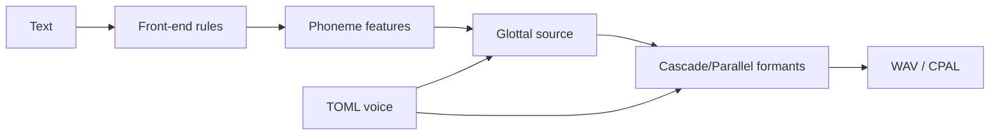

# ARTicul

Classical rule-based articulatory text-to-speech.

ARTicul is a source-filter formant synthesizer in the Klatt tradition: an LF glottal-flow source drives a cascade/parallel resonator bank under rule-based prosody. The core engine is Rust, with an optional C++ resonator inner loop and Python research bindings. Synthesis is fully deterministic — the same input always renders the same output.

```sh
./target/release/articul synthesize --text 'hE "loU' --voice config/default-voice.toml --out hello.wav
```

## Features

- Phonetic feature system covering IPA and extIPA with mechanical lookup
- LF glottal-flow source with aspiration noise, jitter/shimmer, breathiness, and creak
- Klatt-style cascade and parallel formant filters with locus-equation transitions, nasal zeros, and lateral antiformants
- Fujisaki-style F0 (phrase + accent command superposition) and Klatt-style segmental timing
- English stress prosody plus a Korean AP-intonation voice (no lexical stress, phrase-final boundary tones)
- TOML voice configurations with range validation
- CLI synthesis to WAV and realtime playback, plus a NumPy/SciPy-validated Python API
- Deterministic regression suite (fixed-sentence hash, word-balance, spark, and voicing gates)

## Requirements

- Rust 1.91 or later
- A C++ compiler (only for the optional `cpp` resonator backend)
- Python 3 with `numpy` and `scipy` (validation scripts; `librosa` for the reference evaluator)

## Building

```sh
cargo build --workspace --release
```

With the optional C++ resonator inner loop:

```sh
cargo build --workspace --release --features cpp
```

## Quick start

Synthesize English (`demo/hello.wav` renders `hE "loU` — "hello"):

```sh
./target/release/articul synthesize --text 'hE "loU' --voice config/default-voice.toml --out hello.wav
```

Synthesize Korean with the Korean voice (`demo/annyeonghaseyo.wav`, `demo/yeoboseyo.wav`):

```sh
./target/release/articul synthesize --text '%an "njVN "h\asejo' --voice config/korean-voice.toml --out annyeonghaseyo.wav
./target/release/articul synthesize --text '%jV"bo%se%jo' --voice config/korean-voice.toml --out yeoboseyo.wav
```

Realtime playback:

```sh
./target/release/articul play --text 'hE "loU' --voice config/default-voice.toml
```

Run `--help` on any subcommand for the full option list (`--f0` overrides the base pitch).

## Input

Input text is X-SAMPA phonetic symbols. `"` marks primary stress and `%` secondary stress; unmarked words render with the voice default. The full token table lives in `probe/archive/0.0.0.5/0.0.0.5.2/inventory-xsampa.csv`.

## Voices

| File | Use |
| ---- | --- |
| `config/default-voice.toml` | General English, 22050 Hz, base F0 120 Hz |
| `config/korean-voice.toml` | Korean AP intonation, native vowel targets, no lexical stress |
| `config/klatt-voice.toml` | Alternate classical-Klatt tuning |

Voice files are plain TOML (`sample_rate`, `source`, `cascade_formants`, `parallel_formants`, `prosody`) and are range-validated on load.

## Python API

```sh
cargo build -p articul-py --release
copy target/release/articul_py.dll python/articul/_articul.pyd
set PYTHONPATH=python
python python/validation/check_parity.py
```

```python
from articul import lookup, synthesize

print(lookup("p"))
wave = synthesize("hi", 22050, 120.0)
```

`python/validation/eval_reference.py` compares renders against human references (MCD over DTW-aligned MFCCs, F0 RMSE, duration correlation).

## Project layout

```text
crates/articul-phon/    IPA/extIPA feature system and lookup
crates/articul-front/   X-SAMPA parsing, transcription, prosody planning
crates/articul-dsp/     glottal source, cascade/parallel filters, leveler
crates/articul-cli/     `articul` binary (synthesize/play) and render pipeline
crates/articul-config/  TOML voice files with validation
crates/articul-py/      PyO3 bindings (NumPy out)
config/                 voice definitions
demo/                   example outputs
python/validation/      parity and reference-based evaluation scripts
```

## Development

```sh
cargo fmt --check
cargo clippy --workspace --all-targets -- -D warnings
cargo test --workspace
```

All three gates are required before any change lands. The test suite pins synthesis behavior end to end: a fixed-sentence regression hash, word-balance and click gates, spark and voicing gates, and per-voice determinism checks. Expected outputs and measurement logs for completed work live under `probe/archive/` and `logs/archive/`.

## How it works



Text is transcribed to phonemes with stress marks, planned into timed prosodic units (accents, boundary tones, pauses), rendered through the LF source and the filter bank with formant-glide interpolation, then leveled and written as 16-bit mono WAV (or played back via CPAL).

## License

MIT License. See LICENSE.
